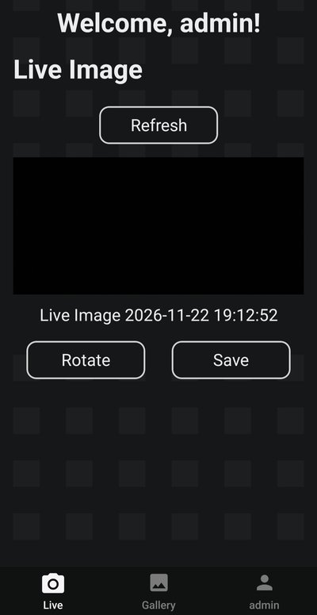
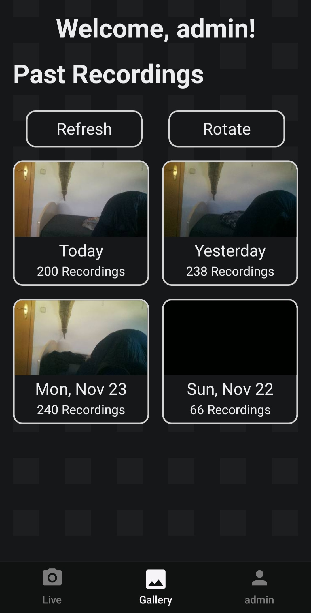
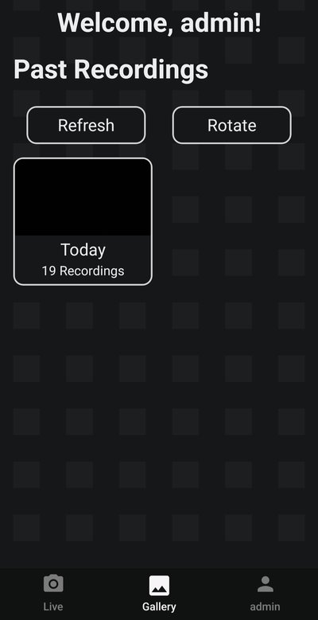

# Security App

<p>
    
    
    
</p>

## Usage Guide

1. Install eas-cli: `npm install -g eas-cli`

2. APK File: Create an APK file by building the application with `npx eas build --platform android`.

3. APK File: Or download the archive from the [latest release](https://github.com/StackOverflowIsBetterThanAnyAI/security-app/releases)

4. Installation: Install the Android app using this APK file.

5. Account Creation: Register a new account. You will automatically be assigned the User role.

6. Gain Access: An Admin must manually change your role to Member.

7. View Images: Once upgraded, you can navigate to the Gallery tab to see the images, which are recorded on a Raspberry Pi Zero W and updated every 5 minutes, or checkout the Live section to view the current camera screen.

## Development Setup

### Prerequisites

- [Node.js](https://nodejs.org/) 24 (same version as the CI workflow) and npm
- An Android smartphone with [Expo Go](https://play.google.com/store/apps/details?id=host.exp.exponent) installed. The project uses **Expo SDK 58**, which requires the current Expo Go version from the Play Store.
- The [backend](https://github.com/StackOverflowIsBetterThanAnyAI/security-backend) running on the Raspberry Pi
- Smartphone, development machine and Raspberry Pi in the same network

### Installation

```sh
git clone https://github.com/StackOverflowIsBetterThanAnyAI/security-app.git
cd security-app
npm ci
```

### Backend Address

The app talks to the backend via plain HTTP. The address is read from `EXPO_PUBLIC_API_URL` in a local `.env` file, which is git-ignored. Copy [`.env.example`](.env.example) to `.env` and set the IP address and port of your Raspberry Pi:

```
EXPO_PUBLIC_API_URL=http://100.x.x.x:5000
```

Restart the dev server after changing `.env`. EAS builds do not see the git-ignored `.env`, so set the variable once per EAS environment as well, for example `eas env:create --name EXPO_PUBLIC_API_URL --value http://100.x.x.x:5000 --environment production --visibility plaintext`. The build profiles in [`eas.json`](eas.json) use the environment of the same name. Use the Pi's [Tailscale](https://tailscale.com) address, so the app reaches the Pi at home and on the go as long as Tailscale is active on the phone. The value is built into the app bundle, so it is configuration, not a secret. The traffic is encrypted by Tailscale, which is why plain HTTP is fine here. Cleartext HTTP is explicitly allowed for Android builds via `usesCleartextTraffic` in [`app.json`](app.json).

Optionally, set the Pi's address in the home network as well, so the app also works at home without Tailscale. Reserve this address for the Pi in the router, so it does not change:

```
EXPO_PUBLIC_API_URL_LOCAL=http://192.168.x.x:5000
```

On start, when it returns to the foreground, every 30 seconds and whenever a request fails, the app checks within 1.5 seconds whether `/health` of the home address answers as the backend. If so, it uses the home address, otherwise the Tailscale address. The check sends no login token, so a foreign device that happens to have the same address in another network never receives it. In the home network, the traffic is not encrypted by Tailscale, so it is only as private as the Wi-Fi itself. For EAS builds, set `EXPO_PUBLIC_API_URL_LOCAL` per environment like `EXPO_PUBLIC_API_URL`.

### Start the App

**Option A: Expo Go** (quickest, no build required)

```sh
npm start
```

Scan the QR code shown in the terminal with the Expo Go app. If the phone cannot reach your machine (e.g. because of a firewall or a guest network), use `npx expo start --go --tunnel`.

**Option B: Development Build** (own app with `expo-dev-client`)

```sh
npx eas build --profile development --platform android
```

Install the resulting APK on the phone, then run `npx expo start --dev-client` and open the project from the installed development app.

### Checks

```sh
npm run lint                 # ESLint (incl. React Compiler rules)
npx tsc --noEmit             # TypeScript
npx expo-doctor              # Expo project health check
npx expo install --check     # dependency versions match the Expo SDK
```

## Backend Repository

[Backend Repository](https://github.com/StackOverflowIsBetterThanAnyAI/security-backend)
